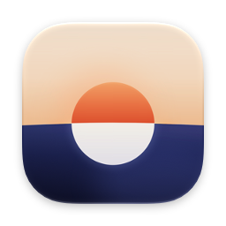
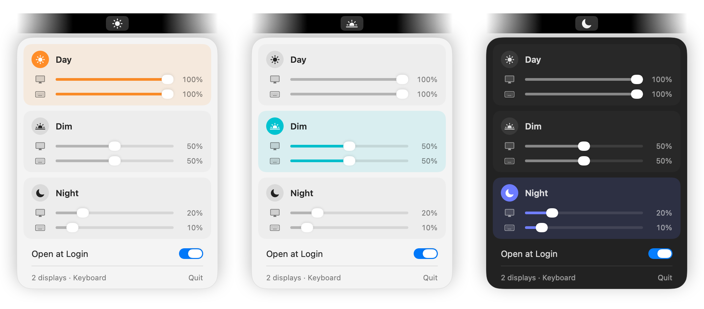

<p align="center">
  
</p>

<h1 align="center">DayNight</h1>

<p align="center">
  One click to dim your screens and keyboard light, and one click to bring them back.
</p>

<p align="center">
  macOS 26 or later &nbsp;·&nbsp; Free and open source
</p>

---

Getting a Mac ready for the evening means turning down each screen and the keyboard light one at a time, then turning them all back up in the morning.

DayNight does it in one click. It sits in your menu bar with three settings: **Day** for full brightness, **Dim** for when you step away from the computer, and **Night** for overnight. Click it and every screen and the keyboard light fade down together. Click again and they come back.

<p align="center">
  
</p>

- **Everything at once.** Every screen and the keyboard light fade together in about half a second.
- **Your levels.** Choose how bright Day, Dim and Night are, for the screens and the keyboard separately.
- **New screens join in.** Plug in a display while Day, Dim or Night is on and it matches the others.
- **Keeps your keyboard light where you put it.** macOS won't nudge it with the room's light while DayNight runs.
- **Nothing to set up.** No permissions to grant. It opens at login and changes nothing until you click.
- **Private.** No account, no tracking, and it never connects to the internet.

## Install

You need macOS 26 or later and [Xcode](https://apps.apple.com/app/xcode/id497799835) 26 or later (free from the App Store). In Terminal, run:

```bash
git clone https://github.com/racejohnson/daynight-menubar-app.git
cd daynight-menubar-app
make install
```

This builds the app, puts it in your **Applications** folder and opens it. To update later, run `git pull` and `make install` again.

## Use it

DayNight has no Dock icon; it lives in your menu bar.

- **Click** the icon to switch between Day and Dim. From Night, a click goes to Day.
- **Option-click** it to switch to Night.
- **Right-click** it (or Control-click) to open the panel:
  - **Day**, **Dim** and **Night**: click a name to switch to it, and drag its sliders to set the screen and keyboard brightness. The one that's on is highlighted, and its sliders change the brightness as you drag.
  - **Open at Login**: on by default.
  - **Quit**.

Out of the box, Day is 100% for the screens and keyboard, Dim is 50% for both, and Night is 20% for the screens and 10% for the keyboard.

The icon shows  for Day,  for Dim,  for Night, and  when the brightness matches none of them.

## Questions

**Which screens does it work with?**
The built-in screen on a MacBook or iMac, and Apple displays such as Studio Display. Most other monitors don't let macOS set their brightness this way, so DayNight leaves them alone. The keyboard light is the backlight on a MacBook's built-in keyboard.

**Why does the icon show a half circle?**
The brightness doesn't match Day, Dim or Night, usually because you changed it with the brightness keys or Control Center. Click once to get back: DayNight picks whichever of Day and Dim is the bigger change, so Dim if your screens are bright and Day if they're dim.

**Will it change my brightness when I log in?**
No. DayNight only changes the brightness when you click.

**My screens drift after I switch.**
macOS may be adjusting them to the light in the room. To keep them exactly where DayNight puts them, turn off **Automatically adjust brightness** in **System Settings → Displays**.

**What happens to my keyboard's automatic brightness?**
DayNight turns it off the first time it sets the keyboard light, so your level doesn't drift. When you quit, it puts it back the way it was. If DayNight ever crashes, it puts it back the next time it opens.

**Why isn't it on the App Store?**
DayNight sets brightness through private parts of macOS that App Store apps aren't allowed to use. A future macOS update could change them. If that happens, DayNight can't change the brightness until it's updated, and nothing else is affected.

**How do I uninstall it?**
Right-click the icon, turn off **Open at Login** and click **Quit**. Then drag DayNight from Applications to the Trash.

## For developers

It's a Swift package; there's no Xcode project.

```bash
make run              # build a copy in .build and open it
make test             # run the tests
make hardware-check   # try Day, Dim and Night on your real screens, then restore them
```

Builds are signed ad hoc. **Open at Login** only works for the copy in Applications, so use `make install` to try it.

The app icon is drawn in `Icon/AppIcon.svg`. `Icon/build-icon.sh` rebuilds `AppResources/Assets.car` and `AppIcon.icns` from it with `rsvg-convert` (`brew install librsvg`), or with Chromium if you set `PLAYWRIGHT` to a Playwright install.

## License

[MIT](LICENSE). The display and keyboard brightness code is adapted from [nriley/brightness](https://github.com/nriley/brightness) and [rakalex/mac-brightnessctl](https://github.com/rakalex/mac-brightnessctl); see [THIRD_PARTY_NOTICES.md](THIRD_PARTY_NOTICES.md). DayNight is an independent project, not affiliated with or endorsed by Apple.
