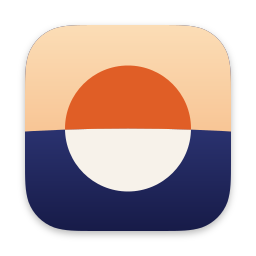
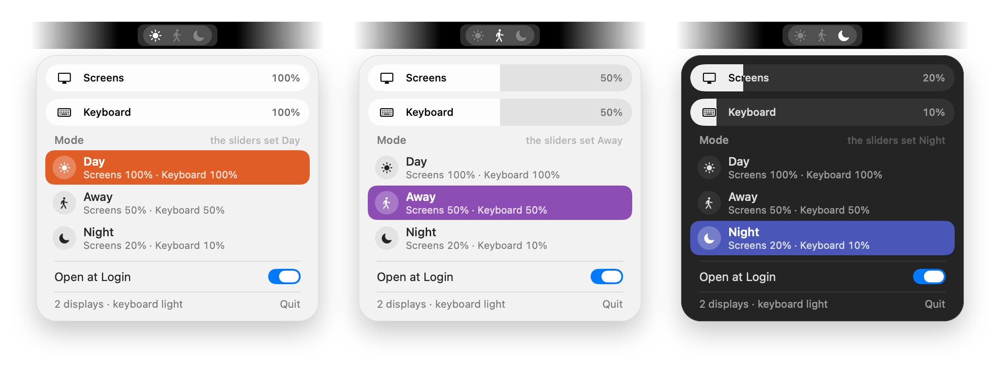
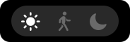
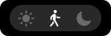
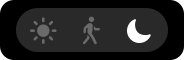
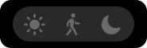

<p align="center">
  
</p>

<h1 align="center">DayNight</h1>

<p align="center">
  One click to dim your screens and keyboard light, and one click to bring them back.
</p>

<p align="center">
  macOS 26 or later &nbsp;·&nbsp; Free and open source
</p>

---

Getting a Mac ready for the evening means turning down each screen and the keyboard light one at a time, then turning them all back up in the morning.

DayNight does it in one click. It sits in your menu bar with three settings: **Day** for full brightness, **Away** for when you step away from the computer, and **Night** for overnight. Click it and every screen and the keyboard light fade down together. Click again and they come back.

<p align="center">
  
</p>

- **Everything at once.** Every screen and the keyboard light fade together in about half a second.
- **Your levels.** Choose how bright Day, Away and Night are, for the screens and the keyboard separately.
- **See it at a glance.** The menu-bar item shows all three, with the one that's on lit.
- **New screens join in.** Plug in a display while Day, Away or Night is on and it matches the others.
- **Keeps your keyboard light where you put it.** macOS won't nudge it with the room's light while DayNight runs.
- **Nothing to set up.** No permissions to grant. It opens at login and changes nothing until you click.
- **Private.** No account, no tracking, and it never connects to the internet.

## Install

You need macOS 26 or later and [Xcode](https://apps.apple.com/app/xcode/id497799835) 26 or later (free from the App Store). In Terminal, run:

```bash
git clone https://github.com/racejohnson/daynight-menubar-app.git
cd daynight-menubar-app
make install
```

This builds the app, puts it in your **Applications** folder and opens it. To update later, run `git pull` and `make install` again.

## Use it

DayNight has no Dock icon; it lives in your menu bar.

- **Click** the item to switch between Day and Away. From Night, a click goes to Day.
- **Option-click** it to switch to Night, and Option-click again to go back to Day.
- **Right-click** it (or Control-click) to open the panel. While the panel is open, a click on the item just closes it.
  - **The two sliders at the top** are the brightness of your screens and your keyboard light. Drag across one to change it. While Day, Away or Night is on, that also sets how bright that one is from now on.
  - **Day**, **Away** and **Night**: click one to switch to it. The one that's on is filled in, and each says its levels.
  - **Open at Login**: on by default.
  - **Quit**.

Hover over the item for a reminder of what a click does.

Out of the box, Day is 100% for the screens and keyboard, Away is 50% for both, and Night is 20% for the screens and 10% for the keyboard.

The item holds a sun, a walking figure and a moon, and lights the one that's on:  for Day,  for Away and  for Night. When the brightness matches none of them, no mode is on and none is lit: .

From the keyboard: Tab moves between Day, Away and Night, and Return or Space switches to one. Esc closes the panel. With **Keyboard navigation** turned on in System Settings, Tab also reaches the two sliders: the arrow keys move one a step, as the brightness keys do, and Option with an arrow moves it one percent.

## Questions

**Which screens does it work with?**
The built-in screen on a MacBook or iMac, and Apple displays such as Studio Display. Most other monitors don't let macOS set their brightness this way, so DayNight leaves them alone. The keyboard light is the backlight on a MacBook's built-in keyboard. If there's nothing DayNight can set, a click does nothing and the panel says why.

**Why is nothing lit in the menu bar?**
No mode is on: the brightness doesn't match Day, Away or Night, usually because you changed it with the brightness keys or Control Center. Click once to get back: DayNight picks whichever of Day and Away is the bigger change, so Away if your screens are bright and Day if they're dim.

**How do I change how bright Night is?**
Switch to Night, open the panel and drag the two sliders. They set whichever of Day, Away and Night is on.

**What do the sliders do when no mode is on?**
They set the brightness and nothing else. Day, Away and Night stay as they were. If you leave the sliders on a mode's exact levels, that mode comes on.

**Will it change my brightness when I log in?**
No. DayNight only changes the brightness when you click.

**My screens drift after I switch.**
macOS may be adjusting them to the light in the room. To keep them exactly where DayNight puts them, turn off **Automatically adjust brightness** in **System Settings → Displays**.

**What happens to my keyboard's automatic brightness?**
DayNight turns it off the first time it sets the keyboard light, so your level doesn't drift. When you quit, it puts it back the way it was. If DayNight ever crashes, it puts it back the next time it opens.

**Why isn't it on the App Store?**
DayNight sets brightness through private parts of macOS that App Store apps aren't allowed to use. A future macOS update could change them. If that happens, DayNight can't change the brightness until it's updated, and nothing else is affected.

**How do I start over?**
Quit DayNight and run `defaults delete com.racejohnson.DayNight` in Terminal. Day, Away and Night go back to the levels they came with.

**How do I uninstall it?**
Right-click the item, turn off **Open at Login** and click **Quit**. Then drag DayNight from Applications to the Trash. To remove its saved levels too, run `defaults delete com.racejohnson.DayNight` in Terminal.

## For developers

It's a Swift package; there's no Xcode project.

```bash
make run              # build a copy in .build and open it
make test             # run the tests
make hardware-check   # try Day, Away and Night on your real screens, then restore them (needs a second Apple display)
make selftest         # click the real item and panel with synthetic clicks, on made-up screens
make readme           # redraw this page's pictures from the same made-up screens
```

Builds are signed ad hoc. **Open at Login** only works for the copy in Applications, so use `make install` to try it. Only one copy runs at a time, so `make run` quits the installed one first.

| Path | What |
|---|---|
| `Sources/DayNightCore/` | The rules and the hardware. `StateEngine` turns a reading into a mode and a click into a target; `BrightnessController` owns every read and write; `SettingsStore` keeps the levels; `AutoBrightnessGuard` turns keyboard auto-brightness off and puts it back |
| `Sources/DayNightPrivateAPI/` | The private macOS calls for display and keyboard brightness |
| `Sources/DayNight/` | The app: `AppModel`, the menu-bar item (`StatusItemController`, `Glyphs`) and the panel (`PanelController`, `PanelView`). `Demo`, `SelfTest` and `ReadmePictures` are the developer tools behind `make selftest` and `make readme` |
| `Sources/DayNightHardwareCheck/` | `make hardware-check` |
| `Tests/DayNightTests/` | The rules as tests: start here to see what the app promises |
| `Icon/` | The app icon's drawing and build script |
| `docs/` | This page's pictures, redrawn by `make readme` |

Settings live in the app's defaults (`defaults read com.racejohnson.DayNight`).

The panel and the menu-bar item are drawn to match [Audio Priority](https://github.com/racejohnson/audio-priority-menubar-app), by the same author.

The app icon is drawn in `Icon/AppIcon.svg`. `Icon/build-icon.sh` rebuilds `AppResources/Assets.car` and `AppIcon.icns` from it with `rsvg-convert` (`brew install librsvg`), or with Chromium if you set `PLAYWRIGHT` to a Playwright install.

## License

[MIT](LICENSE). The display and keyboard brightness code is adapted from [nriley/brightness](https://github.com/nriley/brightness) and [rakalex/mac-brightnessctl](https://github.com/rakalex/mac-brightnessctl); see [THIRD_PARTY_NOTICES.md](THIRD_PARTY_NOTICES.md). DayNight is an independent project, not affiliated with or endorsed by Apple.
